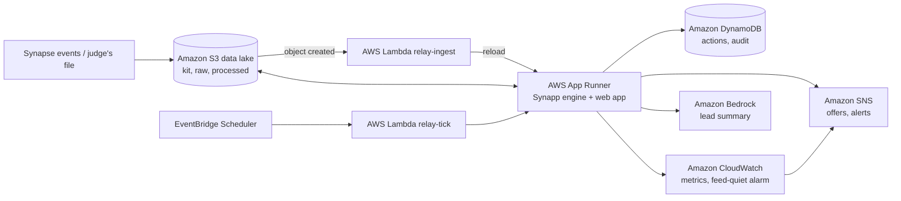

# Synapp

**Sevaro can already see the problems. Synapp gets a neurologist onto them before a stroke patient waits.**

We built Synapp for Rutgers Health Hack 2026 (Sevaro track, Challenge 2: "Tele-Neurology Operations Command Center:
From Visibility to Intervention"). It sits next to Sevaro's Synapse platform, reads the same event stream, works out
what's actually going on across the network, and then helps a coordinator fix it: who to call, who has to approve it,
and what the doctor gets on their phone.

## Why we built it

Here's the moment that got us. At 6:20 PM in the sample data, Sevaro's live view looks fine: most doctors say
"Available". But look closer:

- Nobody approved at Oak Valley Medical is actually free, and a stroke consult there has failed routing three times.
- Suncrest Medical Pavilion has had 5 consults in the last hour when it normally sees 1.
- A stroke consult at Harbor Regional is assigned to a doctor who just set "Temporarily Unavailable".
- Two doctors leave at 7 PM with unsigned notes, and four more leave at 8 PM.

Right now, fixing any of that depends on someone noticing, figuring out by hand who's credentialed and allowed to
help, and picking up the phone. We wanted the screen to do that work.

## What it does

**It figures out what's really happening.** Synapp replays every event in the order it happened (not the order it
arrived), throws out duplicates and puts late records where they belong. It decides whether a doctor is truly free from
their calls, video, camera and desktop agent, not just their self-reported status. It checks every consult against
Sevaro's time standards, compares each hospital to its own normal volume to catch surges, and projects coverage every
15 minutes past the evening shift changes.

**It tells you what to do about it.** Every problem becomes one card: what's going on, where, why it matters and the
recommended fix. Stroke comes first, then anything critical, then anything nobody is working on yet. The fix is always
the least disruptive one that works:

1. reassign to a free doctor on shift
2. wait for someone who's about to free up
3. pull someone off lower-priority work (never off a stroke call)
4. ask a scheduled doctor to start early
5. offer an off-duty doctor a split shift
6. escalate

Every off-duty doctor is checked against every split-shift rule (rest, weekly hours, opt-in, credentials, overlap),
and the app shows the numbers. If nobody qualifies, it escalates. It never bends a rule to make a plan work.

**It closes the loop.** The coordinator proposes, the clinical lead approves in one click, and the doctor gets an offer
on their phone with the hospitals, hours and why they were picked. Nothing about patients. Offers expire after 10
minutes, the first acceptance wins, and everyone else's open offer is withdrawn automatically. Every step lands in an
append-only audit log.

### What it finds in the sample data

- Replaying the event stream reproduces Sevaro's 6:20 PM snapshot exactly: all 8 doctors and all 18 open consults.
- The top two problems are Harbor's stroke consult (ask Dr. Cho, who starts at 7 PM, to start now) and Oak Valley's
  stroke consult with nobody free (offer Dr. Okafor a split shift).
- Of the six off-duty doctors, only Dr. Okafor passes every rule. The rest fail on credentials, an overlapping shift,
  opt-in or the 60-hour week, and the eligibility table shows exactly why.
- That one offer (6:35 to 10:00 PM) covers Oak Valley, the Suncrest surge and the Northfield gap at 8 PM.
- Our routing model reproduces all 4 routing failures in the kit.

## The screens

There's one tab per role. The role switcher is just for the demo; a real deployment would use sign-in.

| Tab | What you see there |
|---|---|
| **Coordinator** | Headline counts, hospital coverage (now and the next three hours), the ranked list of interventions with the recommended fix, and who's on shift. Click a hospital to see who's free, busy or out. |
| **Clinical lead** | What's waiting for approval, stroke consults past their limit, and the coverage outlook. Approve or reject in one step. |
| **Doctor phone** | Exactly what the doctor receives: the offer, a 10-minute countdown, Accept or Decline. |
| **Insights** | How much earlier Synapp would have spotted things in a replay of the day, upcoming handoffs, credentialing gaps and time to doctor per hospital. |
| **Audit log** | Every proposal, approval, message and reply, in plain sentences, with filters. |

A few things worth knowing when you click around:

- When the coordinator reassigns a consult or logs a call, Synapp records it but doesn't change Synapse itself. The
  card shows what you did, with an Undo. For the demo there's a **Simulate Synapse confirming** button that sends the
  events Synapse would send once the reassignment goes through.
- Acknowledged items drop to the bottom of the list, and the next thing that needs attention opens on its own.
- The simulation bar at the bottom moves the clock: +1, +5 or +10 minutes, or play at 60x or 300x so you can watch
  the 7 and 8 PM shift changes happen. **Reset** puts everything back.

## Run it locally

You'll need Python 3 (we use 3.13) and Node 18 or newer.

```bash
pip install -r requirements-dev.txt
cd frontend && npm install && npm run build && cd ..
uvicorn api.main:app --port 8080
```

Then open http://localhost:8080. If you'd rather use Docker: `docker compose up --build`.

Working on the frontend? Run `npm run dev` in `frontend/` (port 5173; it forwards `/api` to 8080).

**Opening it on your phone.** Start the server with `--host 0.0.0.0`, find your computer's IPv4 address with `ipconfig`
(Windows) or `ipconfig getifaddr en0` (Mac), and open `http://<that address>:8080` on a phone on the same Wi-Fi. The
offer screen on its own lives at `/offer/<offer id>`, which is the link shown on the Doctor phone tab. Some campus
networks block phones from reaching laptops; a phone hotspot gets around that.

## Trying it with your own data

### A whole new dataset

Click **Upload new dataset** (top right) and drop in the kit's CSV files or a zip of them. You need hospitals,
doctors on shift, credentialing, coverage requirements and the event stream; the off-shift roster and hourly volume
are optional. File names don't have to match ours. Synapp recognizes each file by its name or, failing that, by its
columns, and it ignores files it doesn't need (like the snapshots).

If something required is missing or a file has the wrong columns, it tells you exactly what and changes nothing.
Otherwise it switches over straight away, sets "now" to the time of the latest record and clears any old offers.
The button turns into **Uploaded data** so you always know what you're looking at, and **Back to the sample data**
undoes it.

We tested this with a copy of the kit where every hospital, doctor and consult ID was renamed and every time was moved
three hours later. The engine finds the same problems.

### New events for the current day

Click **Add events** in the simulation bar and drop in a CSV with the same 8 columns as `event_stream.csv`. Synapp adds
it to the day, skips duplicates, slots late records in by when they actually happened, and recalculates everything
without a restart. It then shows what changed and what to do first.

There are practice files in `data/demo_events/`: a new stroke at Suncrest, a re-call, late and duplicate records, the
7 PM shift change, a quiet feed, and one full of things we didn't plan for. They're written for the sample data, so
they're switched off while an uploaded dataset is in use.

## Tests

```bash
python -m pytest        # 86 tests
```

They cover the exact snapshot match; duplicates, late events and arrival-order replay; re-calls; every split-shift
rule right at its boundary (exactly 10 hours of rest and exactly 60 hours both pass); the whole offer workflow
(approval, expiry, two people accepting, late replies, the weekly cap, retraction, no-shows, the backup approver); the
privacy guard; the flood guard; uploads without a restart; bad data; every practice file; uploading a whole new
dataset (including a zip with odd file names, a missing file and individual CSVs); and a no-hardcoding test that
renames every ID, shifts every time by three hours and changes a credential, then checks the engine still matches.

## Things we thought hard about

- **Doctor fatigue and fairness.** Rest is checked at the offered start time, and this week's hours include the offer.
  Offers go first to whoever can get online fastest, then to whoever has worked fewer hours and had fewer offers this
  week. Declining is never held against anyone. A load meter shows each doctor against a soft limit of 15 consults.
- **When the data stops coming.** "Updated" is always on screen. After 10 quiet minutes a banner appears, the top card
  says the feed is quiet (because everything else might be stale).
- **Patient privacy.** Synapp doesn't store or use any patient information. Matching only uses hospital, consult type,
  stage and timers. Offers come from a fixed template, and a guard blocks consult IDs, event text and clinical words
  from ever going out. Each role sees only its own view.
- **Alert fatigue.** Only critical problems interrupt anyone (auto-escalating after 3 unacknowledged minutes).
  Everything else waits in a ranked, grouped list.
- **Fitting into Synapse.** Synapp models Sevaro's routing rules; it doesn't replace the routing engine. In production
  the events would stream from Synapse (for example through Amazon Kinesis), offers would go through Sevaro's own
  notifications, and sign-in through Sevaro's single sign-on.
- **Licensing.** The kit treats state licensing as part of credentialing, so we do too. A real deployment would add a
  per-state license check to the same eligibility table.

## Next steps: taking it to the cloud

Right now Synapp runs on one machine: the engine, the web app and its data all live together, which is all a demo
needs. The next step is running it on AWS so it can take a live feed from Synapse, stay up around the clock and alert
people even when nobody has the screen open. We've already written the infrastructure as code in `infra/` (AWS CDK in
Python), but we haven't deployed it yet. Here's the plan.




| Service | What it would do |
|---|---|
| Amazon S3 (versioned, KMS) | The event data lake: `kit/`, `raw/` (every file ever added, never overwritten) and `processed/`. Raw files move to Glacier after 30 days. |
| AWS Lambda `relay-ingest` | Checks and loads any file dropped into `raw/`, no restart needed. |
| AWS App Runner (image in ECR) | Runs the engine and the web app over HTTPS. |
| Amazon DynamoDB | Offers, approvals, replies and the audit log. A conditional write is what makes "first acceptance wins" safe. |
| Amazon EventBridge Scheduler | A once-a-minute timer for offer expiry, the backup approver, no-shows, auto-escalation and stale data. |
| Amazon SNS | Sends the offer text and internal alerts. |
| Amazon CloudWatch | Logs, custom metrics and an alarm when no events arrive for 10 minutes. |
| Amazon Bedrock | Writes the two-line summary the clinical lead sees, from structured fields. A template is the fallback, and all decisions are made in code. |
| AWS KMS, Secrets Manager, IAM, CloudTrail | Encryption at rest, secrets kept out of code, least privilege and an audit trail of AWS calls. |

The engine wouldn't change. It already runs either way: locally (`RELAY_ENV=local`, what we use today) a folder stands
in for S3 and DynamoDB, a background thread for EventBridge and an outbox for SNS. On AWS, new event files dropped into
the bucket (`aws s3 cp new_events.csv s3://<bucket>/raw/`) would load on their own, and a CloudWatch alarm would fire
when the feed goes quiet.

### How we would deploy it

The steps are written up in [`infra/README.md`](infra/README.md). The short version, with the AWS CLI signed in and
Docker running:

```bash
npm install -g aws-cdk
cd infra && pip install -r requirements.txt
cdk bootstrap
cdk deploy -c alert_email=you@example.com
```

Optional extras at deploy time: `-c bedrock_model=<a model ID enabled in your account>`,
`-c teams_webhook=<Teams Workflows URL>` and `-c elevenlabs_secret_arn=<Secrets Manager ARN holding the API key>`.

What we expect it to cost at hackathon scale (estimates, so check current pricing): the App Runner instance is most of it, roughly
$10 a month idle and up to about $55 if it's busy around the clock. Add about $1 for KMS, under $1 for Secrets Manager
and about $5 for the CloudWatch alarm, metrics and dashboard. DynamoDB, S3, Lambda and SNS come to cents. All in,
about $20 to $65 a month.

One thing to fix along the way: an uploaded dataset is kept on the server's disk, so on AWS it would only last until
the service restarts. It should move to S3.

### Staying HIPAA-eligible

Synapp would only run on services covered by AWS's Business Associate Addendum. We tried to check AWS's "HIPAA Eligible
Services Reference" page on 10 October 2026, but it wouldn't load from our build environment; a web search confirmed
EventBridge is listed, but we couldn't see the rest. As far as we know (not confirmed against the live page), S3,
Lambda, App Runner, ECR, DynamoDB, EventBridge, SNS, Bedrock, CloudWatch, KMS, Secrets Manager and CloudTrail are all on
it. Before any real use, confirm each one at https://aws.amazon.com/compliance/hipaa-eligible-services-reference/ and
sign the BAA in AWS Artifact.

## Sponsor technology

| Sponsor | How we used it |
|---|---|
| **AWS** | Our planned cloud setup (see Next steps), already written as infrastructure code in `infra/` but not deployed yet. |
| **Sevaro** | Built around Synapse's terms and data. Each hospital gets a "45-second promise at risk" flag when routing would find nobody, to protect Sevaro's OneCall promise when the schedule breaks. |
| **Microsoft** | Accepted shifts download as a calendar invite that opens in Outlook. Approval requests and critical alerts can post to a Teams channel through a Workflows webhook. |
| **ElevenLabs** | "Play offer aloud" reads the offer text in a natural voice when an API key is set (the browser's voice otherwise). Only the guarded offer text is ever sent. |
| **The Cigna Group** | A "value of acting" estimate: what an offer costs in doctor-hours against the simulated drop in waits and unanswered calls. It compares acting with not acting, never one doctor against another. |
| **Anakin** | Not built. We planned a license-watch feature and cut it for time. |

## What's where

- `data/kit/`: the original developer kit files, untouched
- `data/demo_events/`: practice files for the live test
- `engine/`: the Synapp engine (plain Python, no web code)
- `api/`: the FastAPI app that serves the engine and the frontend
- `frontend/`: React, Vite and TypeScript
- `infra/`: the planned AWS setup (CDK stack and Lambda functions), not deployed yet
- `tests/`: the pytest suite
- `config.yaml`: every threshold the engine uses
- `ASSUMPTIONS.md`: every judgment call we made, and why
- `docs/`: the API contract and architecture diagram
- `SUBMISSION.md` and `VIDEO_SCRIPT.md`: our submission write-up and demo script

All the data in this repository is synthetic.
