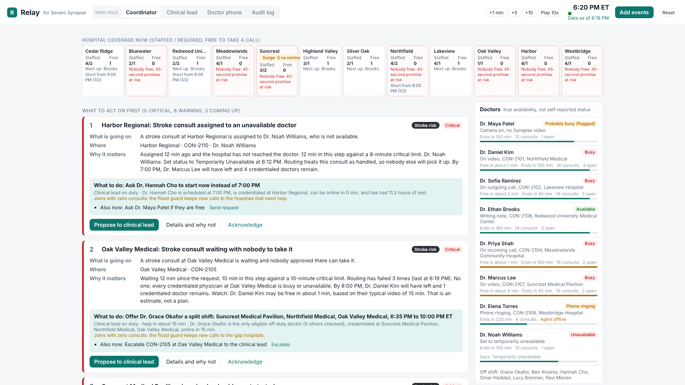
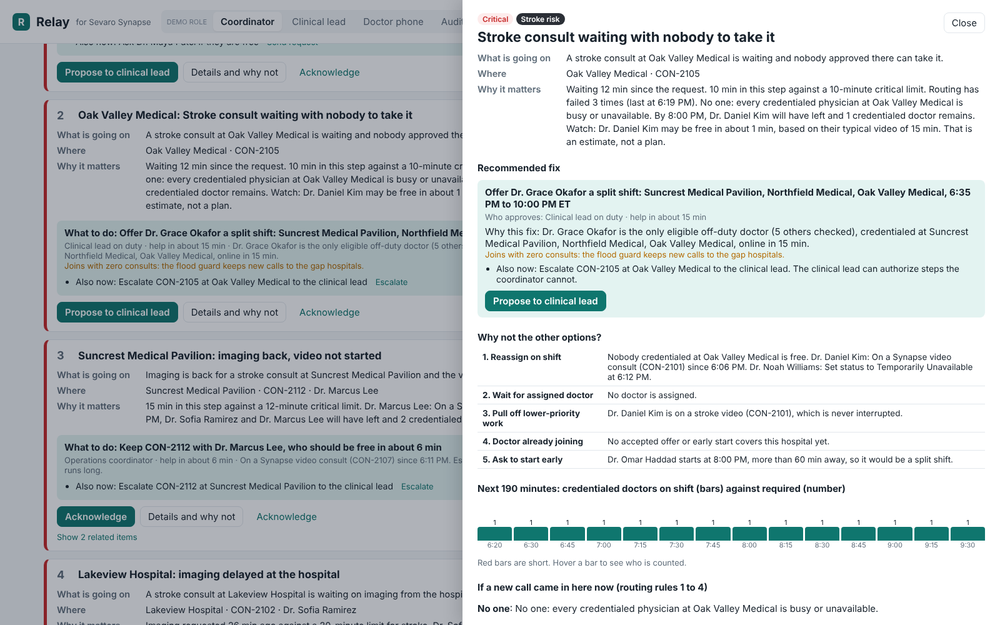
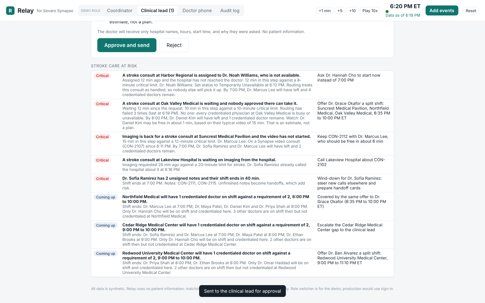
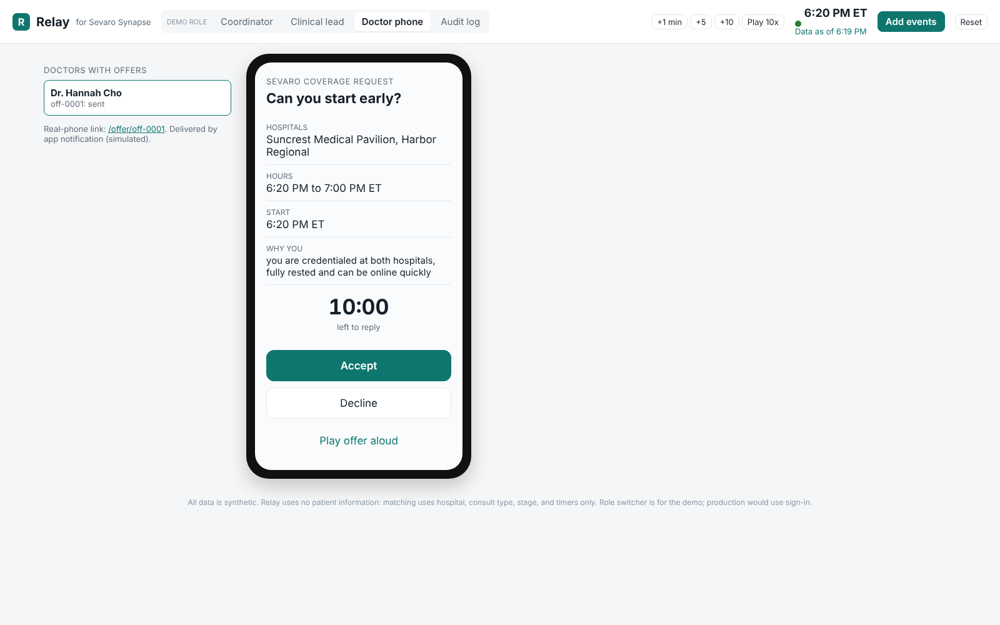
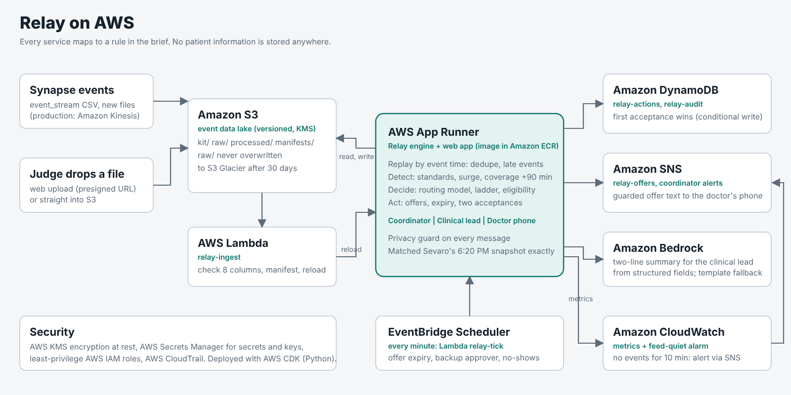
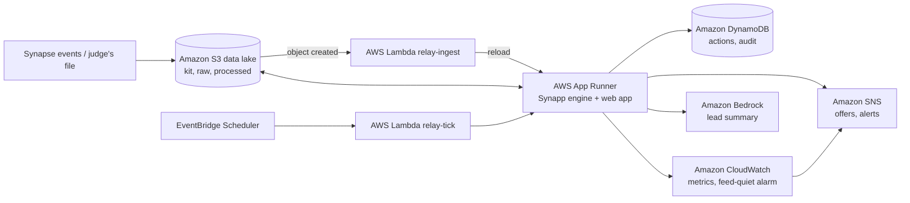

# Synapp

**Sevaro can already see problems. Synapp gets a doctor covering the gap before a stroke patient waits.**

Synapp is our entry for Rutgers Health Hack 2026, Sevaro track, Challenge 2: "Tele-Neurology Operations Command Center:
From Visibility to Intervention." It sits next to Sevaro's Synapse platform. It rebuilds the true state of the network
from the event stream, finds what needs attention now and in the next 90 minutes, recommends the fix, gets a person to
approve it, sends the offer, and closes the loop.



## The problem

At 6:20 PM Sevaro's live view looks fine: most doctors show "Available". But nobody approved at Oak Valley Medical is
free, and a stroke consult there has failed routing three times. Suncrest Medical Pavilion has had 5 consults in an
hour when its normal busy level is 1. A stroke consult at Harbor Regional is assigned to a doctor who just set
"Temporarily Unavailable". Two doctors leave at 7 PM with unsigned notes, and four more leave at 8 PM. Today, fixing
this depends on someone noticing, working out by hand who is credentialed and eligible, and calling them.

## What Synapp does

**Detect.** Synapp replays every event in the order it happened (not the order it arrived), drops duplicates, and
places late records where they belong. It infers who is really free from calls, video, camera, and the desktop agent,
never from self-reported status alone. It checks every consult against Sevaro's time standards, compares each hospital
with its own normal level to spot surges, and projects staffed coverage every 15 minutes past the 7, 8, and 9 PM shift
changes.

**Decide.** Every problem becomes a card that answers four questions: what is going on, where, why it matters, and what
to do (with who approves and why this fix over the others). Cards are ranked by a fixed rule: stroke first, critical
first, nobody working on it first, re-calls move up, longer wait first. The fix comes from a ladder, least disruptive
first: reassign, wait for a doctor about to free up, pull someone off lower-priority work (never a stroke call), ask a
scheduled doctor to start early, offer a split shift, escalate. Every off-duty doctor is checked against every
split-shift rule, with the numbers. If nobody qualifies, Synapp escalates. It never bends a rule.

**Act.** The coordinator proposes; the clinical lead on duty approves in one step; Synapp sends the offer to the
doctor's phone with hospital names, hours, start time, and why them, and nothing else. Offers expire after 10 minutes.
The first acceptance wins; a second gets "This shift is already filled". When someone accepts, projected coverage
updates, routing keeps the new doctor on the hospitals that need help (the flood guard), and every other open offer is
retracted. Every step lands in an append-only audit log.

### On the kit data at 6:20 PM

- Replaying the event stream reproduces Sevaro's reference snapshot exactly: all 8 doctors and all 18 open consults.
- Top of the queue: Harbor's stroke consult assigned to an unavailable doctor (ask Dr. Cho, scheduled at 7 PM, to start
  now), then Oak Valley's stroke consult with nobody free (offer Dr. Okafor a split shift and escalate now).
- Of six off-duty doctors, only Dr. Okafor meets every rule. The others fail on credentialing, overlap with a scheduled
  shift, opt-in, or the 60-hour week, and the table shows each one's numbers.
- One offer, 6:35 PM to 10:00 PM, covers Oak Valley, the Suncrest surge, and the Northfield gap at 8 PM.
- The routing model reproduces all 4 routing failures recorded in the kit.

### Screens

| Coordinator | Clinical lead | Doctor phone |
|---|---|---|
| Ranked queue, hospital coverage, true availability | Approve or reject in one step, with a plain summary | The offer, a 10-minute countdown, Accept or Decline |
|  |  |  |

The Insights tab has the replay scoreboard ("Synapp would have flagged the Suncrest surge at 5:55 PM, 25 minutes before
6:20 PM"), credentialing impact, handoff cards for doctors near shift end, and time to doctor per hospital.

## Architecture





| Service | Why it is there |
|---|---|
| Amazon S3 (versioned, KMS) | Event data lake: `kit/`, `raw/` (every file ever added, never overwritten), `processed/`. Cheap tiered storage: `raw/` moves to Glacier after 30 days. |
| AWS Lambda `relay-ingest` | A file dropped into `raw/` is checked and loaded with no restart. A judge can drop a file straight into the bucket. |
| AWS App Runner (image in Amazon ECR) | Runs the engine and the web app over HTTPS. |
| Amazon DynamoDB | Offers, approvals, replies, and the append-only audit log. A conditional write makes "first acceptance wins" safe. |
| Amazon EventBridge Scheduler | A timer every minute: offer expiry, backup approver, no-shows, auto-escalation, stale data. |
| Amazon SNS | Delivers the guarded offer text and internal alerts. |
| Amazon CloudWatch | Logs, custom metrics, and an alarm when no events arrive for 10 minutes. |
| Amazon Bedrock | Writes the two-line clinical lead summary from structured fields; a template is the fallback. Decisions are made in code. |
| AWS KMS, Secrets Manager, IAM, CloudTrail | Encryption at rest, secrets out of code, least privilege, an audit trail of AWS calls. |

Everything is defined in `infra/` with the AWS Cloud Development Kit (CDK) in Python. The same engine runs locally with
no AWS (`RELAY_ENV=local`): a folder instead of S3 and DynamoDB, a background thread instead of EventBridge, an outbox
instead of SNS. The demo never depends on the cloud being up.

## Run it locally

```bash
pip install -r requirements-dev.txt
cd frontend && npm install && npm run build && cd ..
uvicorn api.main:app --port 8080
```

Open http://localhost:8080. Or with Docker: `docker compose up --build`.

For frontend development, run `npm run dev` in `frontend/` (port 5173, proxies `/api` to 8080).

## Text-message offers (Twilio)

By default offers appear in the Doctor phone tab (simulated). To send real texts, copy `.env.example` to `.env`
(git-ignored), fill in your Twilio account SID, auth token and sender number, and set `RELAY_DEMO_PHONE` to your
own phone. Restart the app. The Clinical lead's button then reads **Approve and send text**.

- The text carries only hospital names, hours and the reason (the same guarded template), plus
  "Reply 1 to accept or 2 to decline." The doctor replies **1** (accept), **2** (decline) or **ONLINE** (logged in).
- Replies reach Synapp at `POST /api/twilio/sms`. Point your Twilio number's "A message comes in" webhook at
  `<RELAY_PUBLIC_URL>/api/twilio/sms`; locally, expose port 8080 with a tunnel such as ngrok and set `RELAY_PUBLIC_URL`
  to that https address. Every webhook is checked against Twilio's `X-Twilio-Signature`; unsigned requests get a 403.
- Delivery status (queued, delivered, failed) shows on the Clinical lead's decisions and in the audit log.
  A failed text leaves the offer open in the app and says so.
- First acceptance wins and offers expire after 10 minutes, exactly as in the app. Replies are logged by intent only.
- Trial accounts can only text verified numbers, and Twilio's trial docs say custom message text may be limited to
  its own templates. If a text shows as failed with a Twilio error, check your account type first.

## Deploy to AWS

Full steps are in [`infra/README.md`](infra/README.md). In short, with the AWS CLI signed in and Docker running:

```bash
npm install -g aws-cdk
cd infra && pip install -r requirements.txt
cdk bootstrap
cdk deploy -c alert_email=you@example.com
```

Optional sponsor features at deploy time: `-c bedrock_model=<a model ID enabled in your account>`,
`-c teams_webhook=<Teams Workflows URL>`, `-c elevenlabs_secret_arn=<Secrets Manager ARN holding the API key>`.

**Rough monthly cost at hackathon scale** (check current AWS pricing; these are estimates): one App Runner instance
with 1 vCPU and 2 GB is the main cost (roughly $10 a month idle, up to about $55 if busy around the clock); KMS key
about $1; Secrets Manager under $1; CloudWatch alarm, five custom metrics and a dashboard about $5; DynamoDB on demand,
S3, Lambda (about 43,000 timer calls a month), and SNS cost cents. About $20 to $65 a month in total.

## Load new events during a demo (the live test)

Click **Add events** and drop the CSV (same 8 columns as `event_stream.csv`). Synapp adds it to the day it already has,
drops duplicates (by ID and by content), places late records by when they happened, moves "now" to the latest arrival,
and recalculates everything with no restart. The result shows what changed, the new top issue, and the fix.

On AWS you can also run `aws s3 cp new_events.csv s3://<bucket>/raw/`.

Practice files live in `data/demo_events/` (a new stroke at Suncrest, a re-call, late and duplicate records, the 7 PM
shift change, a quiet feed, and a file full of things we did not plan for). **Reset** returns to the kit at 6:20 PM.
The clock controls (+1, +5, +10, Play) move the engine clock so offer expiry and no-shows can be shown.

## Tests

```bash
python -m pytest        # 83 tests
```

They cover the exact snapshot match; duplicates, late events and arrival-order replay; re-calls; every split-shift
rule with boundaries (exactly 10 hours rest and exactly 60 hours pass); the offer workflow (approval, expiry, two
acceptances, late replies, weekly cap, retraction, no-shows, backup approver); the privacy guard; the flood guard;
uploads without restart; bad data; every practice file; and a **no-hardcoding test** that renames every ID, moves
every time 3 hours later, and changes a credential, then checks the engine still matches the transformed snapshot.

## Going further

- **Doctor fatigue and fairness.** Rest is checked at the offered start. Hours this week include the offer. Offers are
  ranked by speed to get online, then fewer hours and fewer offers this week. Declines are never held against a doctor.
  A load meter shows each doctor against a soft limit of 15 consults.
- **When data stops arriving.** "Data as of" is always on screen. After 10 quiet minutes a banner appears, the top card
  says the feed is quiet, and on AWS a CloudWatch alarm fires.
- **Patient privacy (HIPAA).** Synapp stores and uses no patient information. Matching uses hospital, consult type,
  stage, and timers only. Offers come from a fixed template, and a guard blocks consult IDs, event text, and clinical
  words. Each role sees only its own view. Storage is lean: operational events only, raw files to Glacier after 30
  days.
- **Alert overload.** Only critical issues interrupt (auto-escalation after 3 unacknowledged minutes). Everything else
  waits quietly in a ranked, grouped queue. CloudWatch counts alerts sent.
- **Fitting into Synapse.** Synapp models Sevaro's routing rules; it does not replace the routing engine. In production
  events would stream from Synapse through Amazon Kinesis into the same engine, offers would go through Sevaro's
  notification system, and sign-in through Sevaro's single sign-on.
- **Licensing.** The kit folds state licensing into credentialing, so Synapp treats credentialing as the gate. A real
  deployment would add a license check per hospital state to the same eligibility table.

### HIPAA-eligible services

Synapp would run only on services covered by AWS's Business Associate Addendum. We tried to check AWS's live "HIPAA
Eligible Services Reference" page on 10 October 2026, but it would not load from our build environment. A web search
of the page confirmed Amazon EventBridge is listed, but we could not see the rest of the page. To our knowledge
(not confirmed against the live page), S3, Lambda, App Runner, ECR, DynamoDB, EventBridge, SNS, Bedrock, CloudWatch,
KMS, Secrets Manager, and CloudTrail are on the list. Before any production use, confirm each one at
https://aws.amazon.com/compliance/hipaa-eligible-services-reference/ and sign the BAA in AWS Artifact.

## Sponsor technology

| Sponsor | How Synapp uses it |
|---|---|
| **AWS** | The whole cloud architecture above, deployed with CDK. |
| **Sevaro** | Built around Synapse terms and data. A "45-second promise at risk" flag on each hospital when routing would find nobody, protecting Sevaro's OneCall promise when the schedule breaks. |
| **Microsoft** | Accepted shifts download as a calendar invite that opens in Outlook. Approval requests and critical alerts can post to a Microsoft Teams channel through a Workflows webhook. |
| **ElevenLabs** | "Play offer aloud" reads the guarded offer text in a natural voice when an API key is configured (browser voice otherwise). Only the guarded text is ever sent. |
| **The Cigna Group** | A "value of acting" estimate: what an offer costs in doctor-hours against the simulated drop in waits and unanswered calls. It compares acting with not acting, never doctors by cost. |
| **Anakin** | Not built. A license-watch feature was planned and cut for time. |

## Repository layout

- `data/kit/`: the original developer kit files, unchanged
- `data/demo_events/`: practice files for the live test
- `engine/`: the Synapp engine (pure Python, no web code)
- `api/`: the FastAPI app that serves the engine and the frontend
- `frontend/`: React, Vite, and TypeScript
- `infra/`: AWS CDK stack and the Lambda functions
- `tests/`: pytest suite
- `config.yaml`: every threshold; `ASSUMPTIONS.md`: every interpretation, with the reason
- `docs/`: API contract, architecture diagram, screenshots; `SUBMISSION.md` and `VIDEO_SCRIPT.md` at the root

All data in this repository is synthetic.
